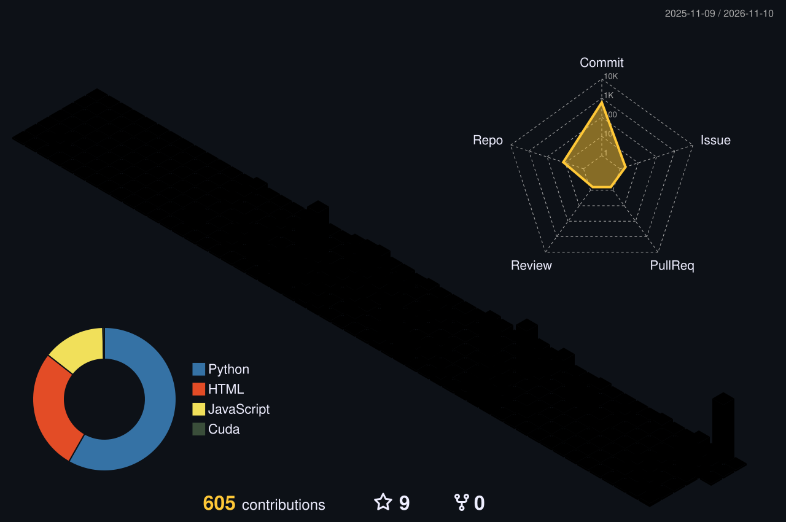

  

<h1 align="center">Hi, I'm 70asunflower! 👋</h1>

  

---

## 🙋 About Me

嗨，我是 **70asunflower**。热爱编程、AI、开源。

正在探索大模型应用开发，构建智能 Agent 系统。

热爱户外运动，喜欢徒步、爬山，享受大自然的自在与宁静。闲暇时爱阅读和听博客，保持好奇心，持续学习、持续成长。

  
  
  
  

---

---

## 🚀 主要项目

| 项目 | 介绍 |
| :--- | :--- |
| [**ai-learning-journey**](https://github.com/70asunflower/ai-learning-journey) | 📚 **AI 学习路径** — LLM / AI Infra / Agent 精选资源与笔记，每条带中文摘要。配技术栈树与[在线索引](https://70asunflower.github.io/ai-learning-journey/)，支持标签筛选、页内读全文 |
| [**ic-chip-design-learning**](https://github.com/70asunflower/ic-chip-design-learning) | 🔬 **芯片设计学习路径** — 从 RTL 到流片：教材 / 课程 / 开源项目 / 工艺资料。技术栈树会标出还没覆盖的技能，方便知道下一步补什么 |
| [**ChatShot**](https://github.com/70asunflower/ChatShot) | 📸 **Chrome 扩展** — 把 AI 对话导出成好看的截图，支持选区、合并、拼接，兼容 DeepSeek / ChatGPT / Gemini 等 |
| [**my-skills**](https://github.com/70asunflower/my-skills) | 🧰 **跨 Agent 技能库** — 一套 skill 供 Claude / Codex / ZCode / Gemini / WorkBuddy 共用：junction 同步、一致性检查、提交闸门 |

## 📊 3D Contribution Graph

  

